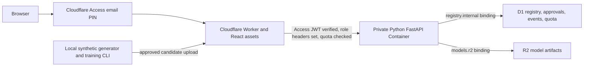

# Telecommunications Churn Platform Project Documentation

**As of 11 November 2026**  
**Live application:** https://telecom-churn-platform.penchalajayasuryachappidi.workers.dev

## Project status

The Cloudflare application is deployed behind Cloudflare Access, and the approved synthetic model `model-847014036e81da10` is the active model in D1. The stored R2 artifact matches its SHA-256 checksum. Local inference succeeds with the recorded scikit-learn version. The Worker, Python test suite, and browser build checks pass.

The project is **not complete against every requirement in the PRD** and is not approved for real subscriber data. The deployed authenticated scoring request has not been re-tested in this audit because browser access is disabled in the current desktop settings. Batch scoring exists in the API, but the dashboard lacks batch upload and export. Drift monitoring and alert delivery are not implemented. Residency requirements are not met by the interim `workers.dev` architecture.

This is an engineering demonstration using synthetic telecom-like records. The model metrics do not measure performance at a telecom provider and do not establish retention impact.

## Product purpose

The platform demonstrates a governed churn-model lifecycle for four project roles:

- **Analyst:** submit synthetic snapshots for a score and review model-behavior factors.
- **ML operator:** generate synthetic data, run local training, inspect candidate evidence, and register an artifact.
- **Approver:** review a candidate and record an approval or rejection; restore a previously approved version when one exists.
- **Administrator:** perform the project’s privileged operations. In the current API, `admin` can perform every role-protected action.

The initial scope excludes real customer data, production retention campaigns, automated customer contact, and claims of business impact.

## Architecture



| Layer | Current implementation | Notes |
|---|---|---|
| Dashboard | React 19, TypeScript, Vite | Worker serves the built assets from the same host as the API. |
| Edge and identity | Cloudflare Worker, Cloudflare Access email PIN, JWT verification | Worker validates the Access assertion and maps the verified email to a role. |
| API and inference | FastAPI in a private Cloudflare Container | Container outbound internet is disabled. It uses Worker outbound handlers for D1 and R2. |
| Registry and counters | Cloudflare D1 | Holds candidate records, approval events, API events, platform state, and the monthly app quota. |
| Model objects | Cloudflare R2 | Stores the model file under a model-version key. The app verifies its checksum when it loads the active model. |
| Data generation and training | Local Python CLI | Cloud training is intentionally disabled. Training produces a local report and candidate artifact. |
| Cloud placement | Worker on `workers.dev`; Container constrained to APAC | D1 and R2 use location hints, not strict residency guarantees. |

### Request lifecycle

1. Cloudflare Access authenticates the user with email PIN.
2. The Worker verifies the Access JWT, reads the server-side role map, removes client-supplied role headers, and sets trusted identity headers for the private API.
3. The Worker serves dashboard assets or forwards `/v1/` and health routes to the Container. It consumes the app’s D1-backed monthly request quota for API calls.
4. FastAPI validates role and request schema. For scoring, it reads the active model pointer from D1, retrieves the model artifact from R2 when needed, checks the SHA-256, loads the pipeline, and returns a probability, band, threshold, version, timestamp, request ID, and reference-substitution factors.
5. The API records safe request metadata. It does not record the full customer snapshot in routine API events.

## Technology and deployment decisions

| Decision | Selected option | Reason and consequence |
|---|---|---|
| Application | FastAPI and React/TypeScript | Python supports the ML pipeline; React provides the dashboard. |
| Training | Local Python/scikit-learn | Training is reproducible without cloud compute. The cloud training endpoint returns `409` and directs the operator to the CLI. |
| Hosting | Cloudflare Worker plus private Container | One `workers.dev` link serves the app. The Container has a single configured maximum instance and sleeps when idle. |
| Identity | Cloudflare Access email PIN | The Worker verifies JWTs and the server-side role map controls project actions. |
| Registry and artifacts | D1 and R2 | Separates registry metadata and audit/counters from binary model artifacts. |
| Public hostname | `workers.dev` | No custom domain is currently connected. The Worker may execute globally. |
| Quota and budget | 5,000 project API requests/month; $5 alert target accepted | The app quota limits this project’s API requests only. The billing alert is not configured and would not cap total account charges. |
| Data use | Synthetic data only | Current Cloudflare location controls do not satisfy strict India or app-wide APAC processing and storage requirements. |

The older AWS India template under `infra/aws-india` is a retained prototype; it does not describe the deployed Cloudflare system.

## Data contract

The current data contract is version `1.0.0`, defined in `contracts/data-schema-v1.json`. Each generated row contains:

| Field | Purpose | Prediction use |
|---|---|---|
| `customer_id` | Stable synthetic key beginning with `SYN-` | Identifier only; excluded from the model. |
| `snapshot_date` | Date at which the features are observed | Time partitioning only; excluded from the model. |
| `tenure_months` | Length of service | Feature |
| `contract_type` | Month-to-month, one year, or two year | Feature |
| `monthly_charges` | Current recurring charges | Feature |
| `total_charges` | Cumulative charges at snapshot | Feature |
| `internet_service` | DSL, fiber optic, or none | Feature |
| `tech_support` | Whether support is enabled | Feature |
| `usage_gb_30d` | Recent data usage | Feature |
| `support_calls_90d` | Recent support-contact count | Feature |
| `payment_method` | Approved payment category | Feature |
| `autopay_enabled` | Whether automatic payment is enabled | Feature |
| `churn_next_30d` | Synthetic training label | Training only; rejected by prediction validation. |

The generator is deterministic for a fixed seed and options. It writes `dataset.csv` plus `manifest.json`, including generator and schema versions, seed, row count, creation time, and quality checks. Customer-like names, addresses, phone numbers, and emails are not generated.

## Reproduce the current model run

The registered candidate was trained from 5,000 synthetic rows with seed 42. Its dataset version is `ds-28365cd8429c48f9`; run ID is `run-ba00b708db4a40b9`. Training used the deployed API’s Python/scikit-learn family: Python 3.12.16, scikit-learn 1.9.1, and pandas 3.1.1.

Chronological partitions contain 2,969 training rows, 1,004 validation rows, and 1,027 holdout rows. The selected threshold was chosen using validation data at a configured 10% review capacity. The final selected pipeline was evaluated once on the holdout after model selection.

| Evaluation | Rows | PR-AUC | ROC-AUC | Precision | Recall | F1 |
|---|---:|---:|---:|---:|---:|---:|
| Validation, logistic regression | 1,004 | 0.4905 | 0.7254 | 0.5556 | 0.1897 | 0.2828 |
| Validation, no-skill prior | 1,004 | 0.2888 | 0.5000 | 0.0000 | 0.0000 | 0.0000 |
| Holdout, selected pipeline | 1,027 | 0.4425 | 0.7435 | 0.4783 | 0.1686 | 0.2493 |

The four compared entries are the no-skill prior, logistic regression, random forest, and histogram gradient boosting. Logistic regression was selected because it had the highest validation PR-AUC among candidates and beat the no-skill baseline. The threshold is `0.727656879`; the rule is probability greater than threshold. At that threshold, about 9.86% of validation rows were selected for review.

All metrics above are synthetic demonstrations. They do not estimate real customer churn behavior, causal effects, retention campaign success, or commercial lift. The per-record explanation uses single-feature reference substitution; it describes model behavior and is not causal evidence. Global feature importance uses permutation importance on validation data.

## Active model card

| Item | Value |
|---|---|
| Model version | `model-847014036e81da10` |
| State | Approved and active in the live D1 registry |
| Selected estimator | Logistic regression |
| Dataset version | `ds-28365cd8429c48f9` |
| Training run | `run-ba00b708db4a40b9` |
| Candidate comparison | Four entries, including the no-skill prior |
| Threshold | `0.727656879` |
| Artifact SHA-256 | `847014036e81da1029cafbe5ded44340e90926215d985ca927fcce8cd0c544ea` |
| Approval event | Recorded 2026-11-11 05:00:49 UTC; actor and active pointer verified in D1 |
| Limitations | Synthetic-only data and metrics; no representative business validation; explanation is not causal |

The approval event’s recorded reason is simply `approved`. The actor, timestamp, model version, and decision are present, but that reason does not document which evaluation evidence was reviewed. Future approval reasons should state the actual evidence and decision rationale.

For this first activation, the synthetic artifact was uploaded with Wrangler and the D1 registry row was inserted after validating the manifest and checksum because browser file upload was unavailable. The owner then made the approval decision, which is present in the approval event. Future candidates should use the dashboard/API registration path so upload provenance follows the normal application flow.

## API reference

All application API routes pass through the Worker and Cloudflare Access. The documented contract is `contracts/prediction-api-v1.yaml`.

| Method and route | Purpose | Role in FastAPI |
|---|---|---|
| `GET /health/live` | Process liveness | Worker forwards after Access. |
| `GET /health/ready` | Dependency and model readiness | Worker forwards after Access. |
| `GET /v1/overview` | User, environment, model, and project overview | Any authenticated project role |
| `GET /v1/quota` | Project quota usage | Any authenticated project role |
| `GET /v1/model` | Active model metadata | Analyst, ML operator, approver |
| `GET /v1/models` | Candidate and production registry | ML operator, approver |
| `POST /v1/predictions` | Score one synthetic snapshot | Analyst, ML operator, approver |
| `POST /v1/predictions/batch` | Score 1–500 rows, preserving row IDs and row errors | Analyst, ML operator, approver |
| `POST /v1/models/candidates` | Upload manifest and checksummed artifact | ML operator |
| `POST /v1/models/{model_version}/approval` | Approve or reject a candidate | Approver |
| `POST /v1/models/rollback` | Restore a previously approved model | Approver |
| `GET /v1/training-runs` | Read available training reports | ML operator, approver |
| `POST /v1/training-runs` | Cloud training operation | Returns `409`; train locally instead |
| `GET /v1/monitoring/summary` | Service counters and current signal limitations | ML operator, approver |

The API limits candidate uploads to 4 MiB, validates the manifest against the inference schema, and checks that the artifact SHA-256 matches both the manifest and the model-version suffix. Admin is a superuser in the current role dependency.

Batch scoring is supported by the API, but the dashboard currently has only single-record scoring. The dashboard does not offer CSV upload, progress display, or a scored-file export.

## Dashboard guide

The dashboard currently has five sections:

1. **Overview:** environment, active model, pending review count, request quota, and project activity.
2. **Score a customer:** single synthetic snapshot form, probability, risk band, threshold, model version, and reference-substitution factors.
3. **Model registry:** candidate upload, metrics, release gates, approval, rejection, and restore controls.
4. **Training runs:** reports available to the API runtime.
5. **Monitoring:** request count, 5xx rate, active model, schema signal, drift limitations, and label limitations.

In Cloudflare mode, the training report directory is the Container’s temporary `/tmp/churn-artifacts` path. Local training reports are not uploaded to a durable Cloudflare report store by the current code, so the live Training runs page may be empty even though the registry has a candidate manifest.

## Local setup and workflow

Requirements are Python 3.12 or later and Node.js 22 or later. From the project root:

```powershell
python -m pip install -e ".[app,cloudflare]"
npm ci
npm run build
python -m unittest discover -s tests -v
```

Generate and train a new candidate:

```powershell
churn-platform generate --rows 5000 --seed 42 --output data/generated
churn-platform train --dataset data/generated/dataset.csv --output-dir artifacts
```

Start the local API and dashboard in separate terminals:

```powershell
uvicorn churn_platform.api:app --reload
```

```powershell
npm run dev
```

The local Vite server proxies `/v1` calls to FastAPI. Local authentication uses the local demo administrator. The production Worker instead validates Cloudflare Access and the server-side role map.

To register a candidate locally or in production, open **Model registry**, select the candidate’s `manifest.json` and `model.joblib`, and submit. A candidate stays pending until an authorized approver records a decision and reason. Production model approval must remain a separate human action.

## Cloudflare deployment and operations

The live application URL is https://telecom-churn-platform.penchalajayasuryachappidi.workers.dev. The latest Worker release verified during this audit is `876f66fa-5aa3-41ca-aca7-e90027cd909f`. D1 database `churn-registry` and R2 bucket `telecom-churn-models` are bound in `wrangler.jsonc`; the registry migration is under `migrations/0001_registry.sql`.

The Worker enforces a 5,000 API request monthly quota. Worker-level and Container log collection are disabled in the current configuration. Application counters are still stored in D1. The Cloudflare Workers Paid plan is reported active. The agreed $5 monthly billing alert has not been configured and would be a notification rather than a hard cap.

Deploy from the project root after reviewing configuration and building:

```powershell
npm run build
npx wrangler deploy
```

The deployment rebuilds the Container image and needs Docker Desktop’s Linux engine. Do not print or commit Worker secret values. The configured Access values are managed in the Cloudflare dashboard/Worker secrets, including the Access team domain, audience, and role map. The Container is configured for APAC placement, one maximum instance, and a two-minute idle sleep.

### Data location and privacy boundary

The Worker on `workers.dev` may execute globally. The Container is constrained to APAC, but is not India-pinned. The D1 query used in this audit was served from APAC, Singapore (`SIN`); that observation is not a residency guarantee. D1 APAC placement is a hint, and R2 APAC placement is best effort. Cloudflare Regional Services requires a configured custom domain and would not by itself constrain every outbound call or storage placement. There is no project custom domain at present.

The current deployment therefore does not meet a strict India-only or app-wide APAC processing/storage requirement. Use synthetic data only until the architecture and provider guarantees are changed and verified.

## Monitoring, recovery, and known operating limits

The live monitoring endpoint currently summarizes request count, 5xx error rate, active model version, and schema signal limitations. It returns an empty `drift_signals` list and `labeled_performance: null`. There is no feature/prediction distribution baseline, delayed-label evaluation, alert delivery, configured alert threshold, or retraining trigger.

The rollback endpoint can restore a previously approved model and writes an approval event. The current registry has one approved model and no prior approved version, so there is no known-good predecessor to restore yet. A production rollback has not been exercised in this audit.

The Worker route checks returned `302` for `/`, `/health/live`, and `/v1/overview`, which is the expected redirect to Cloudflare Access for unauthenticated requests. The owner previously confirmed a signed-in overview page and authenticated overview/quota/monitoring data. This audit could not open the signed-in browser because browser use is disabled in Work settings, so a fresh production scoring request and live role-boundary check remain unverified.

## Verification record

| Check | Result on 11 November 2026 |
|---|---|
| `python -m unittest discover -s tests -v` | Passed, 25 tests. A Starlette/httpx deprecation warning appeared; it did not fail the suite. |
| `npm run build` | Passed TypeScript checks for app and Worker and generated the Vite production bundle. |
| `npm audit --audit-level=high` | Passed; zero vulnerabilities reported by npm audit. |
| `uv lock --check` | Passed after refreshing the previously stale `uv.lock` against `pyproject.toml`. |
| `uv pip check` against the project virtual environment | Passed; all 34 installed locked packages are compatible. |
| Global host `python -m pip check` | Did not pass because unrelated preinstalled `mediapipe 0.10.31` reports an unsupported platform. `mediapipe` is not a project dependency. |
| Locked-environment Python test rerun | Started under the available Python 3.14.6 virtual environment but produced no test results within about 90 seconds and was stopped. The 25-test run under Python 3.13.13 passed in about 2 seconds; repeat the full suite under the deployed Python 3.12 runtime before a release. |
| Cloudflare D1 active model query | Passed; model state is `approved`, release gates pass, and active pointer references this version. |
| Cloudflare R2 artifact download | Passed in the prior verification; downloaded SHA-256 matched the model manifest. |
| Local model load and synthetic inference | Passed with scikit-learn 1.9.1; sample synthetic probability `0.634634`, threshold `0.727657`. |
| Unauthenticated live route checks | Passed expected Access redirects (`302`) for app, liveness, and overview routes. |
| Authenticated production scoring | Not verified in this audit; browser surfaces are disabled in Work settings. |
| Container rebuild on this host | Not available in this audit; Docker Desktop’s Linux engine returned an API error. The deployed Container application is listed as ready with zero live instances, consistent with the configured idle sleep. |
| Python dependency vulnerability scan | Not run; no Python vulnerability scanner is configured in the repository. |

## PRD implementation matrix

“Met” means the core requirement exists in code and has automated or direct evidence. “Partial” means a meaningful portion exists but a required capability or verification is missing.

| PRD item | Status | Evidence and remaining work |
|---|---|---|
| FR-01 Synthetic data generation | Met | Seeded generator, content-addressed dataset version, manifest, synthetic IDs, quality report. |
| FR-02 Schema and validation | Met | Required fields, ranges, enums, duplicate IDs, target exclusion, actionable validation errors. |
| FR-03 Leakage-safe pipeline | Met | Pipeline preprocessing is fit within training; time-ordered partitions; target and IDs excluded. |
| FR-04 Candidate comparison | Met | No-skill prior and three model families use the same evaluation split. |
| FR-05 Threshold and calibration review | Partial | Calibration and capacity/threshold metrics are in reports; the dashboard does not present calibration curves or threshold trade-offs. |
| FR-06 Prediction API | Partial | Authenticated single and batch routes are implemented; a fresh signed-in production scoring request was not verified. |
| FR-07 Explanations | Partial | Single-feature reference-substitution explanations and validation permutation importance exist; global importance is not surfaced in the dashboard, and per-record factors are not causal. |
| FR-08 Analyst dashboard | Partial | Overview and single-record result page exist. Searchable customer explorer, portfolio risk distribution, segment view, and recent score list are absent. |
| FR-09 Batch scoring and export | Partial | API accepts 1–500 rows and preserves row errors; dashboard batch upload, progress, and export are absent. |
| FR-10 Registry and lineage | Partial | Dataset/run IDs, metrics, dependency metadata, threshold, and checksum are stored. Code revision is not captured; immutable object retention is not enforced; Cloudflare training reports are not durably stored. |
| FR-11 Human approval | Partial | Automated gates and human promotion are enforced and audited. The current approval reason is only `approved`, so the reviewed evidence is not described. |
| FR-12 Controlled retraining | Partial | Local manual CLI produces a gated candidate. Configurable triggers, cloud jobs, resumable status, and async job IDs are absent; cloud training returns `409`. |
| FR-13 Monitoring | Partial | Request counts, 5xx rate, active version, and schema signal limitation are shown. Drift, prediction distributions, delayed-label performance, and production labels are not implemented. |
| FR-14 Alerting and rollback | Partial | Audited rollback endpoint exists. Configurable alert thresholds and alert delivery are absent; no previous approved model is available as a rollback target. |
| FR-15 Audit history | Partial | Approval decisions and safe API events are stored. Training actions, access changes, and environment configuration events are not comprehensively audited. |
| FR-16 Portable configuration | Mostly met | Local/cloud modes and provider-specific bindings are separated from the prediction contract; Cloudflare is the deployed backend and AWS is an unused prototype. |
| FR-17 Automated delivery checks | Partial | Python tests, TypeScript/Vite build, and npm audit exist and pass. There is no CI workflow, formatter/linter/security pipeline, Python vulnerability scan, or repeatable container build available from this host. |
| FR-18 Recovery and errors | Partial | Validation and HTTP failures are handled; prediction IDs and health endpoints exist. Bounded retries, resumable jobs, and end-to-end failure/recovery exercises are absent. |

## Recommended next work

1. Perform a signed-in live score and health-readiness check after confirming Access in the user’s browser. Exercise the active R2 model load and capture the returned model version.
2. Add the analyst explorer and dashboard batch workflow with row-level status and a safe export.
3. Add feature/prediction drift baselines, delayed-label evaluation, configurable alert delivery, and clear signal ownership.
4. Persist full training reports and code revision alongside model lineage. Strengthen approval reasons to identify the evaluation evidence; retain append-only decisions.
5. Add CI for Python tests, TypeScript build, dependency/security checks, and Container build; rerun the suite under the deployed Python 3.12 runtime because the available Python 3.14.6 test rerun did not finish.
6. Define artifact and event retention, D1/R2 backup and restore, model rollback exercise, and container availability objectives.
7. Resolve residency before real data. A custom hostname alone is not sufficient; verify all compute, storage, and operational data paths against the required jurisdiction.
8. Configure the accepted $5 notification target and document that it does not limit the Cloudflare invoice.

## Repository map

| Path | Contents |
|---|---|
| `src/churn_platform/synthetic.py` | Synthetic data generation and dataset manifests |
| `src/churn_platform/schema.py` | Data schema and row validation |
| `src/churn_platform/training.py` | Time splits, preprocessing, candidate evaluation, threshold analysis, explanations, artifacts |
| `src/churn_platform/api.py` | FastAPI routes, auth/roles, registry and artifact adapters, scoring and monitoring |
| `src/workers/index.ts` | Access verification, request quota, Worker routing, D1 and R2 outbound handlers |
| `web/src/App.tsx` | Dashboard views and user operations |
| `contracts/` | Versioned dataset and prediction contracts |
| `migrations/` | D1 schema migrations |
| `tests/` | Python unit/API and training tests |
| `wrangler.jsonc` | Cloudflare Worker, Container, D1, R2, and quota bindings |
| `docs/` | Architecture, deployment, model candidate, project, and interview documentation |

## Key definitions

- **PR-AUC:** area under the precision-recall curve. It is useful for model comparison when churn labels are imbalanced; the reported value is specific to the synthetic dataset.
- **Threshold:** probability cutoff used to assign the configured high-risk band. Here it was chosen on validation data at a review-capacity target; it is not a universal business rule.
- **Holdout:** final time-separated partition evaluated once after selection. It estimates performance only for this synthetic generation process.
- **Drift:** a change in input or prediction distributions. Drift alone does not show that real customer outcomes worsened.
- **Reference substitution:** explanation method that replaces one input field with a training-reference value and observes the score change. It is a model-behavior summary, not causality.
